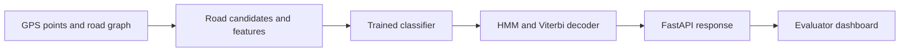
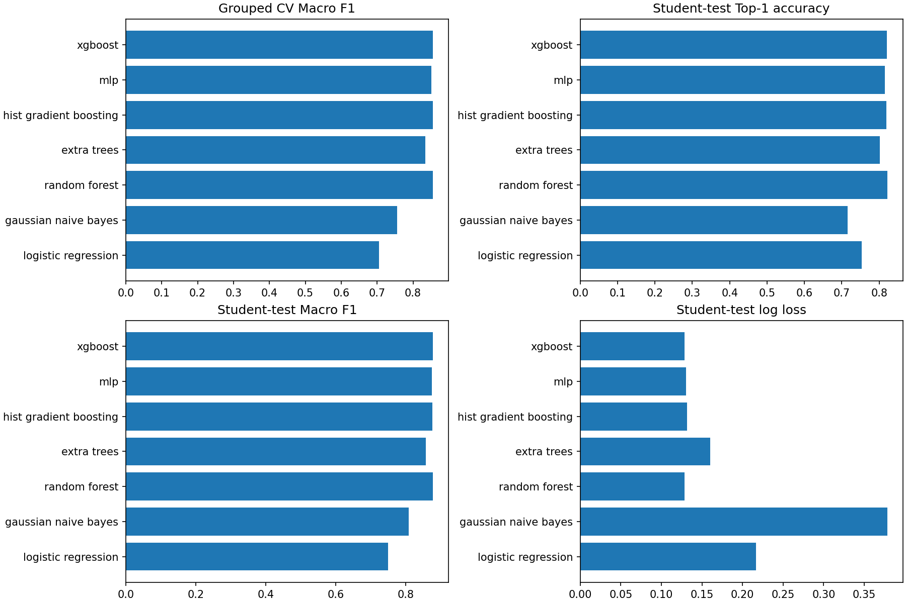
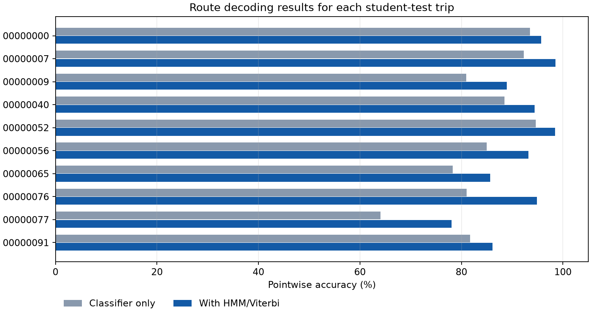

# PathSnap

PathSnap reconstructs a vehicle's route from noisy GPS observations and a directed road network. The evaluator selects a trip in the browser and sees the predicted route, GPS points, pointwise accuracy, and processing time.

[Quick start](#quick-start-on-one-windows-laptop) · [Two-laptop demo](#two-laptop-demo) · [Results](#experiment-results) · [Colab training](#retrain-in-google-colab)

## How the system works



For each GPS point, the backend generates nearby road candidates and scores them using distance, heading agreement, estimated speed, segment length, and position along the segment. Viterbi then picks a sequence using the classifier scores, directed road connectivity, and heading estimated across nearby readings. After prediction, FastAPI compares the selected arcs with reference-aligned arcs to compute accuracy. Reference routes stay on the backend.

## Experiment results

The **18 November 2026** Colab run compared seven classifiers using three trip-grouped validation folds on 80 training trips, then evaluated the models on 10 student-test trips. Histogram Gradient Boosting led the grouped CV Macro F1 comparison and was refit after Bayesian optimisation selected 63 maximum leaves and a learning rate of 0.07.

| Student-test metric | Tuned classifier | With HMM/Viterbi |
| --- | ---: | ---: |
| Pooled pointwise accuracy | 82.08% | **90.37%** |
| Mean trip accuracy | 83.99% | **91.41%** |
| Direct arc continuity | 89.83% | **96.81%** |
| Route arc-overlap F1 | 0.60910 | **0.83385** |

Pooled accuracy weights each GPS reading equally. Mean trip accuracy gives each trip equal weight. See the [full experiment results](artifacts/results.json) and [metric definitions](docs/training.md#read-the-experiment-results).

### Seven-model comparison



### Decoder performance by trip



## Before you start

- Install Git and Python 3.11 for the backend. The evaluator dashboard requires Node.js 20.19+ or 22.12+ and npm.
- Have the supplied `Student folder.zip` on the backend laptop. The commands below assume it is in Downloads. Change the path if you saved it elsewhere.
- The clone includes [the final trained model](artifacts/model.joblib). You can run the demo without retraining in Colab.

## Quick start on one Windows laptop

Use two Command Prompt windows for these commands.

### 1. Clone the repository and start FastAPI

```cmd
cd /d "%USERPROFILE%\Documents"
git clone https://github.com/prathyushg129/ML-Hackathon-PATHSNAP.git PathSnap
cd PathSnap\backend

python -m venv .venv
call .venv\Scripts\activate.bat
python -m pip install -r requirements.txt

set "PATHSNAP_PARTITION=student_test"
set "PATHSNAP_DATA=%USERPROFILE%\Downloads\Student folder.zip"
set "PATHSNAP_MODEL=..\artifacts\model.joblib"
set "PATHSNAP_UI_ORIGINS=http://localhost:5173,http://127.0.0.1:5173"

python -m uvicorn pathsnap.api:app --host 127.0.0.1 --port 8000 --log-level info --access-log
```

Keep the window open. Once startup completes, [open the health endpoint](http://127.0.0.1:8000/health). It should return `{"status":"ready","trip_count":10}`.

### 2. Start the evaluator dashboard

In a second Command Prompt:

```cmd
cd /d "%USERPROFILE%\Documents\PathSnap\frontend"
npm ci
npm run dev
```

Open [the dashboard](http://localhost:5173). Enter `http://127.0.0.1:8000` as the **Backend URL**, click **Connect / refresh**, select a student-test trip, and click **Run prediction**. The backend window logs the trip ID, processing time, and HTTP status.

### 3. Check the API directly

Open [Swagger UI](http://127.0.0.1:8000/docs), or run these commands in a third window:

```cmd
curl.exe http://127.0.0.1:8000/health
curl.exe http://127.0.0.1:8000/trips
curl.exe -X POST http://127.0.0.1:8000/trips/00000052/predict
```

Preserve leading zeros in trip IDs. The prediction response contains GPS observations, matched arc IDs, predicted route geometry, and metrics. Accuracy is returned as a fraction and shown as a percentage in the dashboard.

## Two-laptop demo

1. Join the same Wi-Fi or LAN on both laptops.
2. On the backend laptop, keep the environment settings from the quick start. Stop Uvicorn with **Ctrl+C**, then run:

   ```cmd
   ipconfig
   python -m uvicorn pathsnap.api:app --host 0.0.0.0 --port 8000 --log-level info --access-log
   ```

3. On the UI laptop, clone the repository, change into `frontend`, run `npm ci`, and run `npm run dev`.
4. On the UI laptop, open `http://localhost:5173` and enter `http://<backend-ip>:8000` in **Backend URL**. Use the backend laptop’s active Wi-Fi or Ethernet IPv4 address from `ipconfig`.
5. Click **Connect / refresh**, choose a trip, and run the prediction. Open `http://<backend-ip>:8000/health` on the UI laptop if you need to verify the connection separately.

For the evaluator demo, keep the same model and switch the partition and ZIP in the backend Command Prompt before restarting Uvicorn:

```cmd
set "PATHSNAP_PARTITION=evaluator_test"
set "PATHSNAP_DATA=%USERPROFILE%\Downloads\evaluator_test.zip"
python -m uvicorn pathsnap.api:app --host 0.0.0.0 --port 8000 --log-level info --access-log
```

The evaluator ZIP stays on the backend laptop. Click **Connect / refresh** again to load the reserved trip list.

| If you see | Check |
| --- | --- |
| Health endpoint times out from laptop 2 | Check the backend IP, LAN connection, Uvicorn's `0.0.0.0` binding, and inbound TCP port 8000. |
| Health responds but the dashboard cannot connect | Match `PATHSNAP_UI_ORIGINS` to the dashboard's exact browser origin, including scheme and port, then restart Uvicorn. |
| Startup reports a missing file or wrong trip count | Check the data ZIP path and the selected partition. |
| Map tiles are unavailable | The dashboard can still show GPS and predicted route layers. The Folium report export uses the supplied road geometry as its background. |

## Retrain in Google Colab

1. From the repository root, package `backend/pathsnap`, `backend/requirements.txt`, and `backend/requirements-colab.txt` as described in the [training guide](docs/training.md).
2. Open [the Colab notebook](training/PathSnap_Colab.ipynb). Upload the source ZIP and `Student folder.zip`.
3. Run the setup, training, evaluation, and export cells in order. The notebook compares seven models, performs Bayesian optimisation, and exports the model, metrics, and figures.
4. Extract the downloaded ZIP into `artifacts/` to use the freshly trained model with FastAPI.

## Repository layout

| Folder | Contents |
| --- | --- |
| [backend](backend/) | FastAPI, feature engineering, training, decoding, and map generation |
| [frontend](frontend/) | Vite and Leaflet evaluator dashboard, browser tests, and UI setup |
| [training](training/) | Google Colab notebook |
| [docs](docs/) | Backend setup, training details, and frontend verification |
| [artifacts](artifacts/) | Saved model, full experiment results, and published charts |

[Backend setup](docs/backend.md) · [Frontend setup](frontend/README.md) · [Verification notes](docs/frontend-verification.md)
