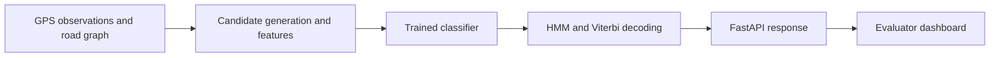

# PathSnap

PathSnap reconstructs a vehicle's route from noisy GPS observations and a directed road network. An evaluator selects a trip in the dashboard and receives the predicted route, pointwise accuracy, and processing time.

## How it works

The classifier scores candidate roads for each observation. The decoder uses road connectivity to choose a sequence across the trip. FastAPI scores the result against the reference route on the backend laptop.

## Results at a glance

The full Colab run compared seven classifiers across three trip-grouped cross-validation folds. Tuned Histogram Gradient Boosting was selected for deployment. On the ten student-test trips, pooled pointwise accuracy rose from **82.08%** with the classifier alone to **90.37%** with HMM/Viterbi. Mean trip accuracy was **91.41%** with equal weight per trip.

See the [comparison chart](artifacts/model-comparison.png), the [per-trip decoder chart](artifacts/decoder-accuracy-by-trip.png), [experiment results](artifacts/results.json), and [metric definitions](docs/training.md#read-the-experiment-results).

## Repository layout

| Folder | Contents |
| --- | --- |
| [backend](backend/) | FastAPI, the shared Python package for preprocessing, model training, HMM/Viterbi and Folium, and Python dependencies |
| [frontend](frontend/) | Evaluator dashboard, Node dependencies, and frontend tests |
| [training](training/) | Google Colab notebook |
| [docs](docs/) | Training, backend setup, and frontend verification guides |
| [artifacts](artifacts/) | Final Colab model, seven-model metrics, Bayesian trials, and the model comparison chart |

## Run PathSnap

1. Use the [final Colab export](artifacts/) or [retrain in Colab](docs/training.md).
2. [Start the backend](docs/backend.md) on the Windows laptop.
3. [Start the evaluator UI](frontend/README.md) and connect it to the backend over the LAN.

For a local check, open [FastAPI Swagger UI](http://127.0.0.1:8000/docs) while the server is running. Use `GET /health` to check readiness, `GET /trips` to list IDs, and `POST /trips/{trip_id}/predict` to run a trip.
